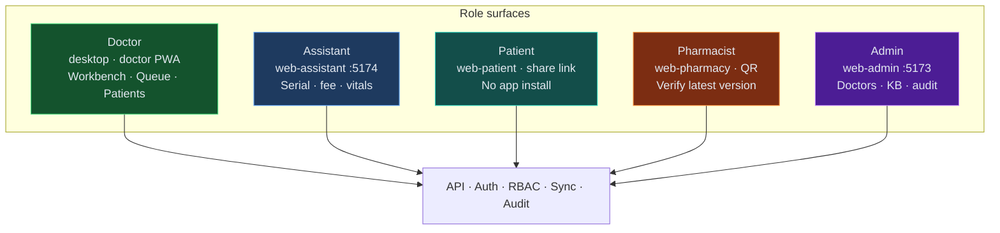
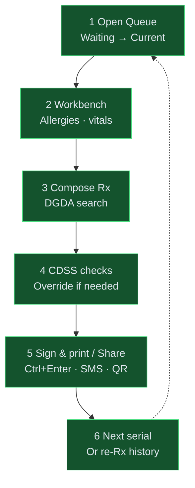
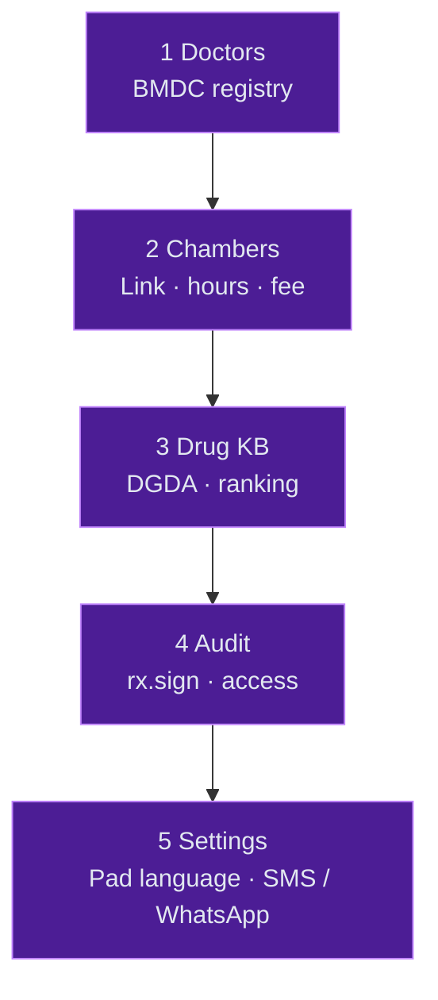

# Clinical OS — Entry points & role workflows

**Audience:** Product, engineering, clinic ops  
**Companion:** [`WORKFLOW.md`](./WORKFLOW.md) (narrative) · [`USAGE_GUIDE.md`](./USAGE_GUIDE.md) (screens)

GitHub renders the Mermaid diagrams below. Colors: Assistant (blue) · Doctor (green) · Patient (teal) · Pharmacy (orange) · Admin (purple).

---

## 1. Visit lifecycle (chamber-day happy path)

---

## 2. App entry points

| Actor | Surface | What they open |
|---|---|---|
| **Doctor** | Desktop / doctor PWA (`apps/desktop`) | Workbench · Queue · Patients |
| **Assistant** | `apps/web-assistant` (:5174) | Serial · fee · vitals |
| **Patient** | `apps/web-patient` · share link | No app install |
| **Pharmacist** | `apps/web-pharmacy` · QR | Verify latest version |
| **Admin** | `apps/web-admin` (:5173) | Doctors · Drug KB · audit |

---

## 3. Role workflows

### 3.1 Doctor

**Entry:** OTP + BMDC · select chamber

Offline path: local write → outbox → sync when online.

### 3.2 Assistant / Receptionist

**Entry:** Staff login · `web-assistant`

**Forbidden:** diagnosis · medications · allergies · clinical advice.

### 3.3 Patient

**Entry:** SMS · WhatsApp · QR · paper pad

No install. Use the newest link if the Rx was amended.

### 3.4 Pharmacist

**Entry:** QR on pad or patient phone

Confirm patient identity, BMDC, and chamber before dispense.

### 3.5 Platform Admin

**Entry:** `SUPER_ADMIN` / `ADMIN` · `web-admin`

---

## 4. Related docs

| Doc | Purpose |
|---|---|
| [`WORKFLOW.md`](./WORKFLOW.md) | Full clinical / ops workflow |
| [`USAGE_GUIDE.md`](./USAGE_GUIDE.md) | Day-to-day screens per role |
| [`DEVELOPER.md`](./DEVELOPER.md) | Architecture and modules |
| [`../README.md`](../README.md) | Repo overview and seeded logins |
