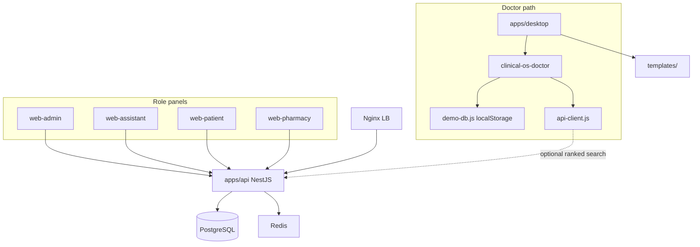

# Clinical OS (BD) — Developer Handbook

**দর্শক:** এই repository-তে কাজ করা engineers  
**প্রোডাক্ট:** Unified Clinical Practice Platform for Bangladesh  
**ট্যাগলাইন:** One Doctor. One Patient Record. Every Chamber.  
**স্ট্যাটাস:** Phase 0 foundation — NestJS/PostgreSQL API + multi-role panels + Electron doctor prototype  
**শেষ review:** 2026-11-26  

> **এই ডকুমেন্ট আপডেট রাখুন।** Meaningful change (module, DB wiring, IPC, schema, dependency, runtime path) হলে নিচের narrative আপডেট **এবং** `python scripts/sync-developer-doc.py` চালান। Cursor agents `.cursor/rules/update-developer-doc.mdc` অনুযায়ী automatic করতে instructed।

Related docs:

| Doc | Purpose |
|---|---|
| [`DEVELOPMENT_PLAN.md`](./DEVELOPMENT_PLAN.md) | Product SDP — pillars, roadmap, stack |
| [`../LOCAL_SETUP.md`](../LOCAL_SETUP.md) | Native PostgreSQL setup (Docker not required) |
| [`../BRANCHING.md`](../BRANCHING.md) | Git branches, panel slices, `demo/*` tags |
| [`SCALE.md`](./SCALE.md) | Load-balance readiness (optional Compose) |
| [`WORKFLOW.md`](./WORKFLOW.md) | Clinical / operational workflows |
| [`USAGE_GUIDE.md`](./USAGE_GUIDE.md) | প্রতিটি user type প্রোডাক্ট ব্যবহার |
| [`../../apps/api/README.md`](../../apps/api/README.md) | API + seed accounts |
| [`../../apps/desktop/README.md`](../../apps/desktop/README.md) | Desktop app quick start |
| [`../../templates/README.md`](../../templates/README.md) | Print/PDF pad kit |
| [`../../app-templates/README.md`](../../app-templates/README.md) | UI kits & stubs map |

---

## 1. এই project কী (What this project is)

Clinical OS বাংলাদেশি private **chamber**-এর জন্য **offline-first clinical practice platform**: fast prescribing, multi-chamber patient history, DGDA drug search, CDSS alerts, assistant-এর জন্য RBAC, print/digital Rx share।

Repository **logical multi-folder monorepo** (root npm workspace নেই)। **ডিফল্ট primary database: native local PostgreSQL**। **NestJS API** (`apps/api`) ছয় role-এ JWT RBAC ও Super Admin–controlled medicine search ranking দেয়। Role-specific Vite panel `apps/web-*` তে। Electron desktop এখনও doctor HTML prototype (localStorage demo EHR) host করে, ranked drug search-এর জন্য **optional** API bridge আছে। **Docker Compose optional** — দৈনন্দিন কাজে লাগে না। Full offline SQLite sync ও production OTP/BMDC planned।

**Clinical note (product):** **Assistant patient allergy chart edit করতে পারে না**; **doctor workbench-এ allergy maintain করতে হবে**। **TODO:** medicine favorites/cache ভবিষ্যতে **per-doctor** ও **discipline-based**।

**`apps/web-assistant`:** assistant/reception panel foundation (queue, serial, vitals, fees; full chart নয়)।

---

## 2. Project কীভাবে তৈরি হয়েছে (bootstrap story)

1. **Product plan** `DEVELOPMENT_PLAN.md` (SDP E-Rx/BD-STRAT/2026/01)।
2. **Print/PDF kit** `templates/` — field catalog, JSON Schema, EN/BN locales, A4/A5 pad HTML, vanilla `PadRender`।
3. **Doctor UI** `app-templates/frontend/clinical-os-doctor` (live prototype + DGDA pack)।
4. **Doctor prototype** `demo-db.js` (localStorage EHR) + DGDA import (`scripts/import-dgda-medicines.py` → `data/dgda-drugs.js`, ~49,826 products)।
5. **Electron shell** `apps/desktop` — doctor UI load, IPC, offline data dirs, Windows NSIS installer।
6. **Docs** `docs/` (workflow, usage, Bengali PDFs `scripts/md_to_pdf_bn.py`)।
7. **API foundation** — NestJS + Prisma + PostgreSQL, multi-role panels, Super Admin medicine ranking, k6 harness; optional Compose/Redis/Nginx।

Root `package.json` **নেই**। প্রতিটি subproject আলাদা install। Desktop UI packaging filesystem + Electron `extraResources`। Panel HTTP/JWT দিয়ে API-তে কথা বলে।

---

## 3. Repository layout

```
prescription/
├── DEVELOPMENT_PLAN.md          # Product & engineering SDP
├── docker-compose.yml           # Optional later stack (not required)
├── docker-compose.scale.yml     # Optional scale profile
├── apps/
│   ├── api/                     # ★ NestJS + Prisma API
│   ├── desktop/                 # Electron doctor shell
│   ├── web-admin/               # SUPER_ADMIN / ADMIN
│   ├── web-assistant/           # ASSISTANT panel
│   ├── web-patient/             # PATIENT share view
│   └── web-pharmacy/            # PHARMACIST verify
├── app-templates/               # UI kits + Clinical OS HTML stubs
├── templates/                   # Rx print/PDF + form JSON contracts
├── loadtest/                    # k6 harness
├── infra/                       # Postgres init + Nginx configs
├── docs/                        # Product + developer handbook
├── scripts/                     # Data/docs tooling + doc sync
└── .vscode/                     # Launch/tasks
```

**Naming rule of thumb**

| Folder | Meaning |
|---|---|
| `apps/` | চালানো ও ship করা product code |
| `app-templates/` | Doctor HTML prototype (`clinical-os-doctor`) |
| `templates/` | Prescription **print/PDF** contracts (app chrome নয়) |

### 3.1 Git branches and demo slices

Remote: `https://github.com/Zis-an/prescription-software.git`

| Branch | Purpose |
|---|---|
| `main` | Full monorepo — default clone |
| `stage` | Pre-production / UAT |
| `production` | Release line; tag `vX.Y.Z` |
| `panel/admin` · `panel/assistant` · `panel/patient` · `panel/pharmacy` · `panel/doctor` | Thin role slices |

Annotated tags: `demo/scaffold`, `demo/api-auth`, `demo/form-save`, `demo/pharmacy`, `demo/doctor`, `demo/full`.

Full workflow: [`docs/BRANCHING.md`](../BRANCHING.md)।

---

## 4. Technologies in use

### 4.1 Implemented today

| Layer | Technology | Evidence |
|---|---|---|
| API | NestJS 10 + Prisma 6 + PostgreSQL 16 | `apps/api/` |
| Auth / RBAC | JWT + Passport; roles enum | `apps/api/src/auth/` |
| Admin / role panels | Vite vanilla JS | `apps/web-*` |
| Desktop runtime | Electron `^33.2.1` | `apps/desktop/package.json` |
| Main/preload language | TypeScript `^5.7.2` → CommonJS `dist/` | `apps/desktop/tsconfig.json` |
| Packaging | electron-builder `^25.1.8` (Windows NSIS) | `apps/desktop/package.json` `build` |
| Doctor UI | Vanilla HTML5 / CSS / IIFE JS | `app-templates/frontend/clinical-os-doctor/` |
| Demo persistence (doctor) | `localStorage` (`clinicalos.demo.v1`) | `demo-db.js` |
| Shared clinical DB | PostgreSQL (native local; optional Compose) | `.env` `DATABASE_URL` · [`LOCAL_SETUP.md`](../LOCAL_SETUP.md) |
| Drug KB (API) | `medicines` table + ranking | Prisma `Medicine` |
| Drug KB (offline pack) | In-memory columnar JS (~50k rows) | `data/dgda-drugs.js` |
| Cache/jobs stub | Redis (optional) | `.env` `REDIS_URL` commented by default |
| LB | Nginx least_conn (optional scale profile) | `infra/nginx/` |
| Load tests | k6 | `loadtest/` |
| Print kit | JSON Schema + vanilla `PadRender` | `templates/` |
| Node requirement | `>=20` | api + desktop `engines` |

### 4.2 Still planned

Encrypted on-device SQLite sync, real OTP + BMDC verify, SMS/WhatsApp, full FHIR export, Next.js PWA port of doctor UI, per-doctor discipline-based medicine favorites (**TODO**).

---

## 5. Modules — inventory, roles, maturity

<!-- AUTO:MODULE_INVENTORY:START -->
_This block is regenerated by `scripts/sync-developer-doc.py`. Do not hand-edit between markers._

| Module | Path | Role | Maturity | Present |
|---|---|---|---|---|
| clinical-os-api | `apps/api` | NestJS + Prisma API, RBAC, medicines ranking, PostgreSQL | Implemented (foundation) | yes |
| clinical-os-desktop | `apps/desktop` | Electron main/preload, IPC, packaging | Implemented (Phase 0) | yes |
| web-admin | `apps/web-admin` | SUPER_ADMIN / ADMIN panel (users, chambers, drug ranking) | Implemented (foundation) | yes |
| web-assistant | `apps/web-assistant` | Assistant queue/serial/vitals/fees panel | Implemented (foundation) | yes |
| web-patient | `apps/web-patient` | Patient Rx share-token view | Implemented (foundation) | yes |
| web-pharmacy | `apps/web-pharmacy` | Pharmacy verify-code panel | Implemented (foundation) | yes |
| clinical-os-doctor | `app-templates/frontend/clinical-os-doctor` | Doctor login/workbench/patients/queue (+ optional API search) | Interactive prototype | yes |
| prescription-template-kit | `templates` | Schemas, forms, A4/A5 pads, preview | Kit implemented; not wired to workbench print | yes |
| repo-scripts | `scripts` | DGDA import, BN PDF, developer-doc sync | Tooling | yes |
| loadtest | `loadtest` | k6 smoke + medicine search burst harness | Foundation harness | yes |
<!-- AUTO:MODULE_INVENTORY:END -->

### Module count (conceptual product modules)

Auto inventory দেখুন। **Active product surfaces:** `apps/api`, `apps/web-*` panels, `apps/desktop` + doctor prototype, `templates` print kit।

---

## 6. Module dependencies and connections

### 6.1 Dependency graph



### 6.2 Roles and panels

| Role | Panel | Notes |
|---|---|---|
| `SUPER_ADMIN` | `apps/web-admin` | Users, chambers, **medicine boost/rank**, audit |
| `ADMIN` | `apps/web-admin` | Users/chambers/audit; ranking view-only |
| `DOCTOR` | desktop + doctor HTML | Prescribe; optional API search; allergy chart workbench |
| `ASSISTANT` | `apps/web-assistant` | Queue/serial/vitals/fees only; allergy edit নেই |
| `PATIENT` | `apps/web-patient` | Share-token Rx view |
| `PHARMACIST` | `apps/web-pharmacy` | Verify-code check |

### 6.3 How modules connect (runtime)

| From → To | Mechanism |
|---|---|
| Panels → API | `fetch` + Bearer JWT (`VITE_API_URL`) |
| API → PostgreSQL | Prisma (`DATABASE_URL`) |
| Nginx → API | Reverse proxy / least_conn (scale) |
| Desktop → Doctor UI | `loadFile` / `CLINICAL_OS_URL` |
| Doctor → Demo DB | `ClinicalOSDB` / `localStorage` |
| Doctor → API medicines | `ClinicalOSApiClient` when `CLINICAL_OS_API_URL` set |
| Import script → local DGDA pack | Python → `dgda-drugs.js`; seed imports subset into PG |

**npm workspace links নেই** apps-এর মধ্যে।

### 6.3 IPC contract

`apps/desktop/src/shared/channels.ts`:

| Channel | Purpose |
|---|---|
| `clinical-os:app-info` | App name, version, platform, entry |
| `clinical-os:data-path` | Offline store root under `userData` |
| `clinical-os:print` | Native print dialog |
| `clinical-os:sync-status` | Offline sync stub |
| `clinical-os:open-external` | Open http(s) URLs only |

Security: `contextIsolation: true`, `nodeIntegration: false`, `sandbox: true`.

---

## 7. Database & storage

### 7.1 Primary database: PostgreSQL (active)

| Item | Value |
|---|---|
| Engine | PostgreSQL 16+ (native install recommended; Compose optional) |
| Connection | `DATABASE_URL` in root `.env` |
| ORM / migrations | Prisma — `apps/api/prisma/schema.prisma` + `prisma/migrations/` |
| Create DB | `scripts/setup-local-db.ps1` or SQL in [`LOCAL_SETUP.md`](../LOCAL_SETUP.md) |
| Migrate / seed | `npx prisma migrate deploy` then `npx prisma db seed` from `apps/api` |
| Locate locally | `localhost:5432`, DB `clinicalos`, user `clinicalos` (see `.env.example`) |
| Extensions | `pg_trgm`, `uuid-ossp` |

**TODO(dgda-auto-import):** DGDA → `medicines` upsert + offline pack refresh automate যখন নতুন drug publish; Super Admin ranking preserve।

**Core tables:** `users`, `chambers`, `user_chambers`, `patients`, `medicines` (`search_rank`, `boost_score`), `prescriptions`, `medication_lines`, `queue_items`, `audit_logs`, `org_settings`.

**Medicine search order (Super Admin controllable):**

`ORDER BY boost_score DESC, search_rank ASC, brand ASC` — `GET /medicines/search`, `PATCH /medicines/:id/ranking` (SUPER_ADMIN only).

### 7.2 Doctor prototype local store (still active)

| Item | Value |
|---|---|
| Technology | `localStorage` JSON |
| Keys | `clinicalos.demo.v1`, `clinicalos.demo.meta` |
| Code | `demo-db.js` |
| Purpose | Offline-feeling doctor demo until sync lands |

### 7.3 Offline desktop dirs (placeholders)

`%APPDATA%\clinical-os-desktop\clinical-os\{db,cache,outbox}` — future encrypted SQLite + sync outbox। PostgreSQL location নয়।

### 7.4 Local DGDA pack (offline formulary file)

`app-templates/frontend/clinical-os-doctor/data/dgda-drugs.js` (~49,826 rows)। Seed subset PostgreSQL-এ (`MEDICINE_SEED_LIMIT`, default 3000)। `CLINICAL_OS_API_URL` থাকলে workbench API ranking; না হলে local fuzzy search.

### 7.5 Contract schemas (print kit)

| Asset | Role |
|---|---|
| `templates/schemas/prescription.schema.json` | Print/form payload contract |
| `templates/catalog/fields.json` | Master field list |
| `templates/catalog/fhir-mapping.json` | Future FHIR export guidance |
| `templates/forms/*.form.json` | In-app form templates |

---

## 8. How each major piece works

### 8.1 Desktop startup

```
npm run dev
  → tsc (src → dist)
  → electron .
  → dist/main/index.js
       → single-instance lock
       → ensureDataDirs()
       → registerIpcHandlers()
       → buildAppMenu()
       → createMainWindow({ entry, remoteUrl })
       → preload exposes clinicalOSDesktop
       → loadFile(doctor HTML) OR loadURL(CLINICAL_OS_URL)
```

| Env var | Effect |
|---|---|
| `CLINICAL_OS_ENTRY` | `login` (default) \| `doctor`/`workbench` \| `patients` \| `queue` |
| `CLINICAL_OS_URL` | Remote PWA load instead of local HTML |

Path resolution (`paths.ts`):

- **Dev:** repo root walk → `app-templates/frontend/clinical-os-doctor` ও `templates/`
- **Packaged:** `process.resourcesPath/ui/doctor` ও `ui/print-templates`

### 8.2 Doctor UI pages

| Page | File | Job |
|---|---|---|
| Login | `login.html` | Demo OTP gate (`123456`) |
| Workbench | `workbench.html` | Compose Rx, CDSS banner, sign/print; **allergy chart** |
| Patients | `patients.html` | Search / open chart |
| Queue | `queue.html` | Serial / waiting list |

Shared: `app.js`, `demo-db.js`, `drug-kb.js`, `shared.css`, `data/dgda-drugs.js`.

### 8.3 Prescription compose → print (current)

1. Demo DB; active patient (session বা queue “current”)।
2. DGDA fuzzy search; draft Rx-এ line add।
3. Demo allergy CDSS (`drug-kb.js` penicillin-class ইত্যাদি)।
4. **Sign & print** → Electron `clinicalOSDesktop.print()` বা `window.print()`।
5. Print **current DOM** — এখনও `PadRender` + `templates/print` নয়।
6. Sync chip demo session / IPC stub — full sync polish planned।

### 8.4 Print template kit

1. `prescription.schema.json` conforming payload।
2. Paper (A5 default / A4), locale (EN / BN)।
3. `PadRender.mount(...)` → `print/shared/*.body.html`।
4. Preview `templates/preview/index.html` (local static server)।

Workbench integration **next step**.

### 8.5 Packaging

`npm run dist:win` in `apps/desktop`:

1. TypeScript compile।
2. electron-builder packs `dist/**` + doctor UI ও `templates/` → `extraResources`.
3. Output: `apps/desktop/release/ClinicalOS-Setup-<version>.exe` (NSIS)।

### 8.6 Admin / role panels

- Live ops: `apps/web-admin` ও অন্য `apps/web-*` Nest API-এর বিরুদ্ধে।
- Assistant: `apps/web-assistant` reception/queue foundation।

---

## 9. Implemented vs planned checklist

| Capability | Status |
|---|---|
| Electron host + secure preload | Done |
| Doctor login / workbench / patients / queue (demo) | Done |
| DGDA drug search (~50k local + PG ranked) | Done |
| Demo EHR in localStorage | Done |
| Native print IPC | Done |
| NestJS API + Prisma + PostgreSQL | Done (foundation) |
| JWT RBAC (6 roles) | Done |
| SUPER_ADMIN medicine ranking | Done |
| Admin / Assistant / Patient / Pharmacy panels | Done (foundation) |
| Local Postgres + Nest API (no Docker required) | Done |
| Optional Compose + Nginx scale profile | Available (optional) |
| k6 load-test harness | Done |
| Offline `db/cache/outbox` folders | Dirs only + **localStorage sync outbox** |
| Online/offline sync engine | Done (foundation) — `sync-engine.js` + `POST /sync/push` |
| Encrypted SQLite local store | Planned |
| Workbench → PadRender print | Planned |
| Real OTP + BMDC auth | Planned |
| Immutable Rx versions + SMS/WA | Partial stubs / planned |
| Per-doctor discipline favorites | **TODO** |

---

## 10. Entry points & common commands

```bash
# Local DB (once) — see docs/LOCAL_SETUP.md
# powershell -File scripts/setup-local-db.ps1

cp .env.example .env

# API (native Postgres; no Docker)
cd apps/api && npm install && npx prisma migrate deploy && npx prisma db seed && npm run start:dev

# Panels
cd apps/web-admin && npm install && npm run dev
cd apps/web-assistant && npm install && npm run dev

# Desktop
cd apps/desktop && npm install && npm run dev

# Load test (API already running)
k6 run loadtest/k6-smoke.js

# Regenerate DGDA pack / docs
python scripts/import-dgda-medicines.py
python scripts/sync-developer-doc.py --note "..."
```

VS Code: task `desktop:dev`, `docs:sync-developer`.

---

## 11. Source map (key files)

| Concern | Path |
|---|---|
| Electron boot | `apps/desktop/src/main/index.ts` |
| Window load | `apps/desktop/src/main/window.ts` |
| IPC handlers | `apps/desktop/src/main/ipc.ts` |
| UI / data paths | `apps/desktop/src/main/paths.ts` |
| Preload bridge | `apps/desktop/src/preload/index.ts` |
| Channel names | `apps/desktop/src/shared/channels.ts` |
| Demo DB | `app-templates/frontend/clinical-os-doctor/demo-db.js` |
| Drug search | `app-templates/frontend/clinical-os-doctor/drug-kb.js` |
| Workbench UI | `app-templates/frontend/clinical-os-doctor/workbench.html` |
| Rx schema | `templates/schemas/prescription.schema.json` |
| Pad renderer | `templates/print/shared/render.js` |

---

## 12. Coding conventions for this repo

1. Doctor shell-এ `apps/desktop` extend করুন; legacy Electron stubs `app-templates/`-এ ফিরিয়ে আনবেন না।
2. IPC channel names `shared/channels.ts`-এ single source of truth।
3. Secret repo-তে নয়; `.env*` gitignored।
4. `templates/` legal pad contract — catalog/schema/locale prefer, one-off HTML hack নয়।
5. localStorage replace করলে `ClinicalOSDB` entity **shape** রাখুন incremental UI migration-এর জন্য।
6. `app-templates/` live doctor prototype-এ সীমিত; নতুন product UI `apps/`-এ।
7. Architecture, storage, modules change হলে **এই handbook** আপডেট (§13)।

---

## 13. Keeping this document up to date

### 13.1 Automatic / semi-automatic system

| Mechanism | What it does |
|---|---|
| `scripts/sync-developer-doc.py` | Repo scan করে AUTO blocks rewrite (module inventory, versions, IPC, changelog) |
| `.cursor/rules/update-developer-doc.mdc` | Cursor agents narrative + sync script |
| VS Code task `docs:sync-developer` | One-click auto sections refresh |
| Optional pre-commit | Script `--check` mode stale block fail |

### 13.2 When you must update manually

Narrative আপডেট (শুধু script নয়) যদি:

- Module add/remove বা connection change  
- Real database, ORM, migration  
- Startup flow, env vars, IPC semantics  
- §9 capability shift  
- Packaging / `extraResources` paths  

### 13.3 Changelog

<!-- AUTO:CHANGELOG:START -->
| Date | Change |
|---|---|
| 2026-11-26 | Native Postgres default; Docker optional; DGDA auto-import TODO |
| 2026-11-25 | Remove unused vendor kits and generated duplicates |
| 2026-11-25 | Document Git branching and panel slices |
| 2026-11-26 | Default runtime = native Postgres (no Docker required); TODO(dgda-auto-import) tagged |
| 2026-11-25 | Docker stack available as optional path; fixed API seed/entrypoint for Nest dist/src/main.js |
| 2026-11-24 | Desktop packages Admin/Assistant/Patient/Pharmacy panels via Panels menu + extraResources |
| 2026-11-24 | Online/offline sync engine: localStorage outbox, health probe, POST /sync/push, live sync chip |
| 2026-11-24 | NestJS PostgreSQL API, multi-role panels, Super Admin medicine ranking, Docker LB + k6 harness |
| 2026-11-24 | Initial developer handbook + sync script + Cursor rule |
<!-- AUTO:CHANGELOG:END -->

Meaningful implementation প্রতি row append (বা sync script `--note "..."`)।

---

## 14. Recommended next engineering steps

1. `getDataPath()/db` তে encrypted SQLite ও `localStorage` migrate।
2. Sign-এ schema-valid payload + `PadRender` + `templates/print` print।
3. Outbox writes + `setSyncStatus` updates polish।
4. Doctor HTML → React/Vite port (বা `CLINICAL_OS_URL`) IPC bridge রেখে।
5. **TODO(dgda-auto-import):** medicine sync automation।
6. Per-doctor discipline-based favorites (**TODO**).

---

<!-- AUTO:SNAPSHOT:START -->
_Generated snapshot — regenerated by `scripts/sync-developer-doc.py`._

- Snapshot time (UTC): `2026-11-26T07:18:45Z`
- Desktop package name/version: `clinical-os-desktop@0.1.0`
- Electron: `^33.2.1`
- TypeScript: `^5.7.2`
- electron-builder: `^25.1.8`
- Node engines: `>=20`
- DGDA drug rows (from meta.count): `49826`
- IPC channels: "clinical-os:app-info", "clinical-os:data-path", "clinical-os:print", "clinical-os:sync-status", "clinical-os:report-sync-status", "clinical-os:open-external"
- Offline dirs (created at runtime): `%APPDATA%/clinical-os-desktop/clinical-os/{db,cache,outbox}`
- Active clinical store today: `localStorage` key `clinicalos.demo.v1`
- Desktop package.json present: `True`
<!-- AUTO:SNAPSHOT:END -->